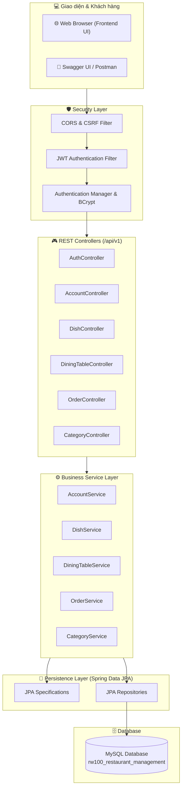
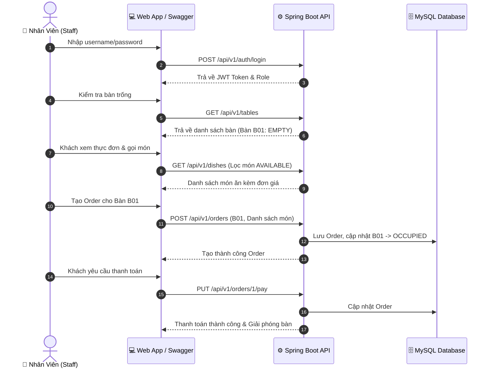

<div align="center">

# 🍽️ RESTAURANT MANAGEMENT SYSTEM (QLNH)
### *Hệ Thống Quản Lý Nhà Hàng & Điểm Bán Hàng (POS) Hiện Đại*

[](https://www.oracle.com/java/)
[](https://spring.io/projects/spring-boot)
[](https://spring.io/projects/spring-security)
[](https://www.mysql.com/)
[](http://localhost:8080/swagger-ui/index.html)
[](LICENSE)

<p align="center">
  <b>Hệ thống backend RESTful API & giao diện quản lý toàn diện dành cho chuỗi nhà hàng, quán ăn, quán cà phê.</b><br>
  Tối ưu hóa quy trình gọi món, điều phối bàn ăn thời gian thực, quản lý thực đơn, tính tiền hóa đơn và phân quyền nhân viên đa cấp.
</p>

<p align="center">
  <a href="#-tính-năng-nổi-bật">Tính Năng</a> •
  <a href="#-kiến-trúc--công-nghệ">Kiến Trúc</a> •
  <a href="#-khởi-động-nhanh">Khởi Động Nhanh</a> •
  <a href="#-tài-liệu-api--swagger-ui">Tài Liệu API</a> •
  <a href="#-kịch-bản-kiểm-thử-demo-workflow">Demo Kịch Bản</a> •
  <a href="#-phân-quyền-truy-cập-rbac">Phân Quyền</a> •
  <a href="#-cấu-trúc-thư-mục">Cấu Trúc</a>
</p>

---

</div>

## 📌 Giới Thiệu Dự Án

**Restaurant Management System (QLNH)** được xây dựng nhằm giải quyết bài toán vận hành thực tế tại các nhà hàng: từ khâu tiếp đón khách, đặt bàn, gọi món (POS), chuyển trạng thái chế biến đến tính tiền và xuất hóa đơn.

Dự án áp dụng kiến trúc chuẩn phân lớp (**Layered Architecture**), tuân thủ các nguyên tắc thiết kế RESTful API, tích hợp cơ chế bảo mật **Stateless Authentication bằng JSON Web Token (JWT)** cùng hệ thống phân quyền chặt chẽ giữa Quản trị viên (`ADMIN`) và Nhân viên phục vụ (`STAFF`).

---

## ✨ Tính Năng Nổi Bật

<table>
  <tr>
    <td width="50%">
      <h3>🔐 Xác Thực & Bảo Mật Đa Tầng</h3>
      <ul>
        <li>Xác thực người dùng qua cơ chế <b>JWT (Stateless Bearer Token)</b>.</li>
        <li>Phân quyền vai trò <b>Role-Based Access Control (RBAC)</b>: <code>ADMIN</code> và <code>STAFF</code>.</li>
        <li>Mã hóa mật khẩu an toàn với thuật toán <b>BCrypt</b>.</li>
        <li>Bộ lọc xử lý ngoại lệ tập trung <b>Global Exception Handler</b> và kiểm tra hợp lệ dữ liệu (Jakarta Validation).</li>
      </ul>
    </td>
    <td width="50%">
      <h3>🪑 Sơ Đồ & Quản Lý Bàn Ăn</h3>
      <ul>
        <li>Theo dõi trạng thái bàn trực quan: <code>EMPTY</code> (Trống), <code>OCCUPIED</code> (Đang có khách), <code>RESERVED</code> (Đã đặt trước).</li>
        <li>Quản lý sức chứa từng bàn (2 chỗ, 4 chỗ, bàn tiệc lớn).</li>
        <li>Tự động chuyển đổi trạng thái bàn khi khách tạo đơn và khi hoàn tất thanh toán.</li>
      </ul>
    </td>
  </tr>
  <tr>
    <td width="50%">
      <h3>🍲 Quản Lý Thực Đơn & Danh Mục</h3>
      <ul>
        <li>Phân loại món theo nhóm: <i>Món chính, Khai vị, Đồ uống, Tráng miệng,...</i></li>
        <li>Tìm kiếm và lọc đa điều kiện bằng <b>Spring Data JPA Specification</b> (theo tên, khoảng giá, danh mục, tình trạng).</li>
        <li>Kiểm soát trạng thái món linh hoạt: <code>AVAILABLE</code> (Sẵn sàng phục vụ), <code>UNAVAILABLE</code> (Tạm hết món).</li>
      </ul>
    </td>
    <td width="50%">
      <h3>📝 Gọi Món & Thanh Toán (POS)</h3>
      <ul>
        <li>Tạo đơn gọi món theo bàn với nhiều món ăn và số lượng tùy biến.</li>
        <li>Tự động tính toán tổng giá trị đơn hàng theo đơn giá thời điểm đặt.</li>
        <li>Hỗ trợ chỉnh sửa món, thêm món mới vào đơn đang phục vụ.</li>
        <li>Xác nhận thanh toán (<code>PAID</code>) và tự động giải phóng bàn về trạng thái <code>EMPTY</code>.</li>
        <li>Hỗ trợ hủy đơn linh hoạt (<code>CANCELLED</code>).</li>
      </ul>
    </td>
  </tr>
  <tr>
    <td width="50%">
      <h3>👥 Quản Trị Nhân Sự & Tài Khoản</h3>
      <ul>
        <li>Quản lý danh sách tài khoản nhân viên và thông tin liên hệ.</li>
        <li>Hỗ trợ cấp phát quyền hạn, đổi mật khẩu và quy trình quên mật khẩu qua Email.</li>
        <li>Chỉ định phân quyền nghiêm ngặt: Nhân viên không thể can thiệp danh sách tài khoản hệ thống.</li>
      </ul>
    </td>
    <td width="50%">
      <h3>🌐 Đa Ngôn Ngữ & Tiện Ích Mở Rộng</h3>
      <ul>
        <li>Hỗ trợ quốc tế hóa <b>i18n</b> đa ngôn ngữ: 🇻🇳 Tiếng Việt, 🇬🇧 Tiếng Anh, 🇫🇷 Tiếng Pháp.</li>
        <li>Tích hợp <b>Spring Mail</b> gửi email xác nhận và thông báo hệ thống.</li>
        <li>Giao diện quản lý Frontend tinh gọn, trực quan, tương thích đa thiết bị.</li>
      </ul>
    </td>
  </tr>
</table>

---

## 🏛️ Kiến Trúc & Công Nghệ

### 🛠️ Tech Stack Chi Tiết

| Thành phần | Công nghệ / Thư viện | Vai trò |
| :--- | :--- | :--- |
| **Ngôn ngữ** | Java 17 LTS | Ngôn ngữ phát triển chính |
| **Framework** | Spring Boot 3.5.x | Nền tảng phát triển ứng dụng lõi |
| **Bảo mật** | Spring Security 6 & JJWT 0.11.5 | Xác thực JWT Token & Phân quyền RBAC |
| **Cơ sở dữ liệu** | MySQL 8.x & Hibernate / Spring Data JPA | Quản lý quan hệ dữ liệu & ORM |
| **Validation** | Jakarta Bean Validation | Kiểm tra tính hợp lệ dữ liệu đầu vào |
| **Mapping** | ModelMapper 3.2.6 | Ánh xạ DTO ↔ Entity hiệu năng cao |
| **Tài liệu hóa API** | Springdoc OpenAPI 2.8.9 (Swagger UI) | Tạo tài liệu tương tác & Test API |
| **Email Service** | Spring Boot Starter Mail | Dịch vụ gửi email thông báo |
| **Công cụ tiện ích** | Lombok, Apache Commons Lang 3 | Giảm thiểu mã nguồn thừa, tối ưu code |
| **Frontend** | HTML5, CSS3, JavaScript ES6+ | Giao diện quản trị & POS gọi món |

### 🧩 Sơ Đồ Kiến Trúc Hệ Thống



---

## 📁 Cấu Trúc Thư Mục

```text
QLNH/
├── .mvn/wrapper/                  # Maven Wrapper binaries & configs
├── src/
│   ├── main/
│   │   ├── java/com/vti/
│   │   │   ├── config/            # Cấu hình Security, JWT, Swagger, ModelMapper, i18n
│   │   │   │   ├── AuthAcessDeniedHandler.java
│   │   │   │   ├── AuthEntryPoint.java
│   │   │   │   ├── I18nConfig.java
│   │   │   │   ├── JWTFilter.java
│   │   │   │   ├── JWTUtils.java
│   │   │   │   ├── ModelMapperConfig.java
│   │   │   │   ├── OpenApiConfig.java
│   │   │   │   └── SecurityConfig.java
│   │   │   ├── controller/        # REST Endpoints tiếp nhận request
│   │   │   │   ├── AccountController.java
│   │   │   │   ├── AuthController.java
│   │   │   │   ├── CategoryController.java
│   │   │   │   ├── DiningTableController.java
│   │   │   │   ├── DishController.java
│   │   │   │   └── OrderController.java
│   │   │   ├── dto/               # Data Transfer Objects (phản hồi API)
│   │   │   ├── entity/            # JPA Entities (Ánh xạ bảng CSDL)
│   │   │   ├── enums/             # Enum vai trò, trạng thái đơn, trạng thái bàn
│   │   │   ├── exception/         # Xử lý ngoại lệ tập trung (Global Exception Handler)
│   │   │   ├── form/              # Request Body Forms & bộ lọc
│   │   │   ├── frontend/          # Giao diện web quản lý (HTML, CSS, JS)
│   │   │   │   ├── assets/        # CSS styles & Module API JavaScript
│   │   │   │   ├── index.html     # Dashboard tổng quan
│   │   │   │   ├── login.html     # Đăng nhập hệ thống
│   │   │   │   ├── tables.html    # Quản lý sơ đồ bàn ăn
│   │   │   │   ├── dishes.html    # Quản lý món ăn
│   │   │   │   └── orders.html    # Quản lý gọi món & POS
│   │   │   ├── repository/        # Tầng truy xuất CSDL (Spring Data JPA)
│   │   │   ├── service/           # Tầng nghiệp vụ (Interfaces & Implementations)
│   │   │   ├── specification/     # Bộ lọc tìm kiếm động JPA Specification
│   │   │   └── validation/        # Custom Validators (ví dụ: xác thực trùng username)
│   │   └── resources/
│   │       ├── application.properties # Cấu hình Datasource, JPA, JWT, Mail
│   │       ├── data.sql               # Dữ liệu mẫu khởi tạo tự động
│   │       └── messages_*.properties  # File từ điển đa ngôn ngữ (vi, en, fr)
├── pom.xml                        # Quản lý thư viện Maven
└── README.md                      # Tài liệu dự án
```

---

## ⚡ Khởi Động Nhanh

### 1. Yêu Cầu Môi Trường

Đảm bảo máy tính của bạn đã cài đặt:
- **Java Development Kit (JDK)**: Phiên bản `17` trở lên
- **MySQL Server**: Phiên bản `8.0` trở lên
- **Maven**: Phiên bản `3.8+` (hoặc sử dụng sẵn file `mvnw` đi kèm)

### 2. Cài Đặt & Cấu Hình

**Bước 1: Clone kho mã nguồn về máy**
```bash
git clone https://github.com/iamvu3006/QLNH.git
cd QLNH
```

**Bước 2: Cấu hình kết nối cơ sở dữ liệu**

Mở file `src/main/resources/application.properties` và điều chỉnh thông tin tài khoản MySQL của bạn:
```properties
spring.datasource.url=jdbc:mysql://localhost:3306/rw100_restaurant_management?createDatabaseIfNotExist=true
spring.datasource.username=root
spring.datasource.password=your_password_here

# Tự động đồng bộ cấu trúc bảng và nạp dữ liệu mẫu
spring.jpa.hibernate.ddl-auto=update
spring.sql.init.mode=always
spring.sql.init.data-locations=classpath:data.sql
spring.jpa.defer-datasource-initialization=true
```

**Bước 3: Khởi động ứng dụng**

Sử dụng Maven Wrapper:

- **Trên Windows (PowerShell/CMD):**
  ```powershell
  .\mvnw.cmd spring-boot:run
  ```
- **Trên Linux / macOS:**
  ```bash
  chmod +x mvnw
  ./mvnw spring-boot:run
  ```

Hệ thống sẽ tự động tạo cơ sở dữ liệu `rw100_restaurant_management` và chèn dữ liệu mẫu ban đầu qua file `data.sql`.

**Bước 4: Trải nghiệm ứng dụng**

Sau khi server khởi động thành công tại cổng `8080`:
- **Giao diện Swagger UI:** [http://localhost:8080/swagger-ui/index.html](http://localhost:8080/swagger-ui/index.html)
- **Tài liệu OpenAPI Docs:** [http://localhost:8080/v3/api-docs](http://localhost:8080/v3/api-docs)
- **Giao diện Web Frontend:** Mở file `src/main/java/com/vti/frontend/login.html` trên trình duyệt (hoặc qua VSCode Live Server).

---

## 🔑 Tài Khoản Mặc Định

Dữ liệu khởi tạo mặc định gồm 2 tài khoản mẫu phục vụ kiểm thử:

| Tài khoản (Username) | Mật khẩu | Quyền hạn (Role) | Mô tả vai trò |
| :--- | :--- | :--- | :--- |
| `admin` | `123456` | <span style="color:red">**ADMIN**</span> | Toàn quyền quản trị hệ thống, tài khoản nhân sự, danh mục, món ăn, bàn ăn |
| `staff01` | `123456` | <span style="color:blue">**STAFF**</span> | Nhân viên phục vụ: xem thực đơn, tạo/sửa order, phục vụ bàn và thanh toán |

---

## 📑 Tài Liệu API & Swagger UI

Dự án tích hợp trực tiếp **Swagger UI** tương tác trực quan:

```text
http://localhost:8080/swagger-ui/index.html
```

> **Cách xác thực trên Swagger UI:**
> 1. Gọi API `POST /api/v1/auth/login` với tài khoản `admin` hoặc `staff01`.
> 2. Sao chép chuỗi `token` nhận được từ phản hồi.
> 3. Click nút 🔒 **Authorize** ở góc trên bên phải màn hình Swagger UI.
> 4. Nhập vào ô giá trị theo định dạng: `Bearer <token_vua_copy>`.
> 5. Nhấn **Authorize** để kích hoạt quyền gọi các API được bảo vệ.

---

## 📡 Danh Sách API Endpoints Chính

<details open>
<summary><b>1. Xác thực & Tài khoản cá nhân (/api/v1/auth)</b></summary>
<br>

| Phương thức | Endpoint | Quyền hạn | Mô tả |
| :--- | :--- | :--- | :--- |
| `POST` | `/api/v1/auth/login` | Công khai | Đăng nhập tài khoản & nhận JWT token |
| `POST` | `/api/v1/auth/register` | Công khai | Đăng ký tài khoản người dùng mới |
| `GET` | `/api/v1/auth/me` | Đã xác thực | Lấy thông tin cá nhân của phiên đăng nhập hiện tại |

</details>

<details open>
<summary><b>2. Quản lý Nhân sự & Tài khoản (/api/v1/accounts)</b></summary>
<br>

| Phương thức | Endpoint | Quyền hạn | Mô tả |
| :--- | :--- | :--- | :--- |
| `GET` | `/api/v1/accounts` | ADMIN, STAFF | Lấy danh sách tài khoản (hỗ trợ phân trang/tìm kiếm) |
| `GET` | `/api/v1/accounts/{id}` | ADMIN, STAFF | Xem chi tiết thông tin một tài khoản theo ID |
| `POST` | `/api/v1/accounts` | **ADMIN** | Tạo tài khoản nhân viên mới |
| `PUT` | `/api/v1/accounts/{id}` | **ADMIN** | Cập nhật thông tin tài khoản |
| `DELETE` | `/api/v1/accounts/{id}` | **ADMIN** | Xóa tài khoản khỏi hệ thống |

</details>

<details open>
<summary><b>3. Quản lý Danh mục & Thực đơn (/api/v1/categories & /api/v1/dishes)</b></summary>
<br>

| Phương thức | Endpoint | Quyền hạn | Mô tả |
| :--- | :--- | :--- | :--- |
| `GET` | `/api/v1/categories` | Đã xác thực | Lấy danh sách danh mục món ăn |
| `POST` | `/api/v1/categories` | **ADMIN** | Thêm mới danh mục món ăn |
| `GET` | `/api/v1/dishes` | Đã xác thực | Lấy danh sách món ăn (lọc theo tên, giá, danh mục, status) |
| `GET` | `/api/v1/dishes/{id}` | Đã xác thực | Xem thông tin chi tiết món ăn |
| `POST` | `/api/v1/dishes` | **ADMIN** | Tạo món ăn mới vào thực đơn |
| `PUT` | `/api/v1/dishes/{id}` | **ADMIN** | Chỉnh sửa thông tin món ăn (giá, ảnh, trạng thái) |
| `DELETE` | `/api/v1/dishes/{id}` | **ADMIN** | Xóa món ăn khỏi thực đơn |

</details>

<details open>
<summary><b>4. Quản lý Bàn ăn (/api/v1/tables)</b></summary>
<br>

| Phương thức | Endpoint | Quyền hạn | Mô tả |
| :--- | :--- | :--- | :--- |
| `GET` | `/api/v1/tables` | Đã xác thực | Xem sơ đồ & danh sách bàn ăn kèm trạng thái |
| `GET` | `/api/v1/tables/{id}` | Đã xác thực | Xem chi tiết thông tin bàn theo ID |
| `POST` | `/api/v1/tables` | **ADMIN** | Thêm bàn ăn mới vào sơ đồ |
| `PUT` | `/api/v1/tables/{id}` | **ADMIN** | Cập nhật số bàn hoặc sức chứa |
| `DELETE` | `/api/v1/tables/{id}` | **ADMIN** | Xóa bàn ăn khỏi danh sách |

</details>

<details open>
<summary><b>5. Đơn hàng & Gọi món - POS (/api/v1/orders)</b></summary>
<br>

| Phương thức | Endpoint | Quyền hạn | Mô tả |
| :--- | :--- | :--- | :--- |
| `GET` | `/api/v1/orders` | Đã xác thực | Lấy danh sách đơn hàng (lọc theo bàn, trạng thái, ngày) |
| `GET` | `/api/v1/orders/{id}` | Đã xác thực | Xem chi tiết đơn hàng (danh sách món, số lượng, thành tiền) |
| `POST` | `/api/v1/orders` | ADMIN, STAFF | Tạo đơn gọi món mới cho bàn ăn |
| `PUT` | `/api/v1/orders/{id}` | ADMIN, STAFF | Điều chỉnh thêm/bớt món ăn trong đơn |
| `PUT` | `/api/v1/orders/{id}/pay` | ADMIN, STAFF | Thực hiện thanh toán & giải phóng bàn về `EMPTY` |
| `PUT` | `/api/v1/orders/{id}/cancel` | ADMIN, STAFF | Hủy đơn gọi món & giải phóng bàn |

</details>

---

## 🧪 Kịch Bản Kiểm Thử (Demo Workflow)

Dưới đây là chu trình vận hành chuẩn 7 bước từ lúc tiếp khách đến khi thanh toán:



<details>
<summary><b>Xem chi tiết Payload mẫu từng bước kiểm thử (cURL / JSON)</b></summary>
<br>

### Bước 1: Đăng nhập & Lấy JWT Token
```bash
curl -X POST "http://localhost:8080/api/v1/auth/login" \
     -H "Content-Type: application/json" \
     -d '{"username": "admin", "password": "123456"}'
```
*Phản hồi mẫu:*
```json
{
  "token": "eyJhbGciOiJIUzI1NiJ9.eyJzdWIiOiJhZG1pbiIsImlhdCI6MTY...",
  "id": 1,
  "username": "admin",
  "fullName": "Admin Hệ Thống",
  "role": "ADMIN"
}
```

### Bước 2: Xem sơ đồ bàn ăn
```bash
curl -X GET "http://localhost:8080/api/v1/tables" \
     -H "Authorization: Bearer <TOKEN>"
```

### Bước 3: Xem thực đơn món ăn
```bash
curl -X GET "http://localhost:8080/api/v1/dishes?status=AVAILABLE" \
     -H "Authorization: Bearer <TOKEN>"
```

### Bước 4: Tạo Order gọi món cho bàn B01
```bash
curl -X POST "http://localhost:8080/api/v1/orders" \
     -H "Content-Type: application/json" \
     -H "Authorization: Bearer <TOKEN>" \
     -d '{
       "tableId": 1,
       "orderItems": [
         { "dishId": 1, "quantity": 2 },
         { "dishId": 3, "quantity": 2 }
       ]
     }'
```
*(Bàn B01 sẽ tự động đổi trạng thái từ `EMPTY` sang `OCCUPIED`)*

### Bước 5: Xem chi tiết hóa đơn
```bash
curl -X GET "http://localhost:8080/api/v1/orders/1" \
     -H "Authorization: Bearer <TOKEN>"
```

### Bước 6: Hoàn tất thanh toán
```bash
curl -X PUT "http://localhost:8080/api/v1/orders/1/pay" \
     -H "Authorization: Bearer <TOKEN>"
```
*(Đơn hàng được đánh dấu `PAID`, bàn B01 tự động chuyển về `EMPTY`)*

</details>

---

## 🔒 Phân Quyền Truy Cập (RBAC)

Hệ thống bảo vệ nghiêm ngặt các thao tác quan trọng thông qua bộ lọc bảo mật:

| Nghiệp Vụ / Endpoint | ADMIN | STAFF | Kết quả khi STAFF gọi API Admin |
| :--- | :---: | :---: | :--- |
| **Thêm nhân viên mới** (`POST /api/v1/accounts`) | ✅ | ❌ | `403 Forbidden` |
| **Chỉnh sửa nhân viên** (`PUT /api/v1/accounts/{id}`) | ✅ | ❌ | `403 Forbidden` |
| **Xóa nhân viên** (`DELETE /api/v1/accounts/{id}`) | ✅ | ❌ | `403 Forbidden` |
| **Thêm / Xóa món ăn** (`POST/DELETE /api/v1/dishes`) | ✅ | ❌ | `403 Forbidden` |
| **Thêm / Xóa bàn ăn** (`POST/DELETE /api/v1/tables`) | ✅ | ❌ | `403 Forbidden` |
| **Tạo Order & Thêm món** (`POST /api/v1/orders`) | ✅ | ✅ | `200 OK` |
| **Thanh toán Order** (`PUT /api/v1/orders/{id}/pay`) | ✅ | ✅ | `200 OK` |
| **Xem thực đơn & Bàn ăn** (`GET /dishes`, `GET /tables`) | ✅ | ✅ | `200 OK` |

---

## 🤝 Hướng Dẫn Đóng Góp (Contributing)

Mọi đóng góp nhằm cải tiến dự án đều được chào đón! Hãy làm theo các bước sau:

1. **Fork** dự án về tài khoản cá nhân của bạn.
2. Tạo nhánh tính năng mới:
   ```bash
   git checkout -b feature/tinh-nang-moi
   ```
3. Commit các thay đổi tuân theo quy chuẩn **Conventional Commits**:
   ```bash
   git commit -m "feat: bổ sung tính năng in hóa đơn PDF"
   ```
4. Đẩy mã nguồn lên remote branch:
   ```bash
   git push origin feature/tinh-nang-moi
   ```
5. Mở một **Pull Request** và mô tả chi tiết các cải tiến.

---

## 📄 Bản Quyền & Tác Giả

- **Tác giả:** [iamvu3006](https://github.com/iamvu3006)
- **Tổ chức / Đào tạo:** VTI Academy
- **Giấy phép:** Được phát hành dưới giấy phép [MIT License](LICENSE).

<div align="center">
  <sub>Được xây dựng với sự tâm huyết dành cho lập trình viên Java & Spring Boot. Nếu thấy dự án hữu ích, hãy tặng cho repo một ⭐ <b>Star</b> nhé!</sub>
</div>
